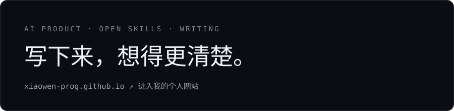

# 你好，我是 xiaowen

把一个问题拆开，把一种方法写成工具，再把想法放进真实的项目里。

[个人网站](https://xiaowen-prog.github.io/) · [文章](https://xiaowen-prog.github.io/#articles) · [GitHub](https://github.com/xiaowen-prog?tab=repositories)

---

## 项目

### 开源 Skills

| 项目 | 简介 |
| --- | --- |
| [**学习吸收教练** · absorption-learning-coach](https://github.com/xiaowen-prog/absorption-learning-coach) | 通过闭卷回忆、迁移练习与疲劳感知辅导，帮助吸收文章和视频内容。 |
| [**AI 产品拆解** · ai-product-teardown](https://github.com/xiaowen-prog/ai-product-teardown) | 真实场景取证、效果评测、人机分工、技术机制与可复核的产品分析。 |
| [**中文细分需求挖掘与验证** · cn-demand-discovery](https://github.com/xiaowen-prog/cn-demand-discovery) | 面向个人与小团队，发掘、排序并低成本验证中国市场的细分产品需求。 |
| [**Web Design Director** · web-design-director](https://github.com/xiaowen-prog/web-design-director) | 为落地页、产品页和作品集确定设计方向、构图与验收。 |

### 个人网站

| 项目 | 简介 |
| --- | --- |
| [**个人网站** · xiaowen-prog.github.io](https://github.com/xiaowen-prog/xiaowen-prog.github.io) | 把文章、个人标签与开源项目放在同一个空间。当前页面的源码也在这里。 |

[全部 GitHub 项目 ↗](https://github.com/xiaowen-prog?tab=repositories)

---

## 文章

- [我把大佬们说的“AI 时代最重要的能力”翻过来看了看](https://mp.weixin.qq.com/s/991gkOPc_dxUtg0GhJzMNw)
- [被奶龙缠上以后，我把 AI 视频这几年翻了一遍](https://mp.weixin.qq.com/s/RY9eMBEdMJ6khyxHIeZZwQ)
- [从一个单身狗的视角看情感陪伴](https://mp.weixin.qq.com/s/_IqunA-lFHbJ18ao4acZag)
- [一个没有 App 的 AI 助理，让我重新想了想 App 的未来](https://mp.weixin.qq.com/s/trM4W-DfzQEhNQi-qBW-xw)

---

## 技能

    

## 工具

   

---

更多内容见 [个人网站](https://xiaowen-prog.github.io/)
